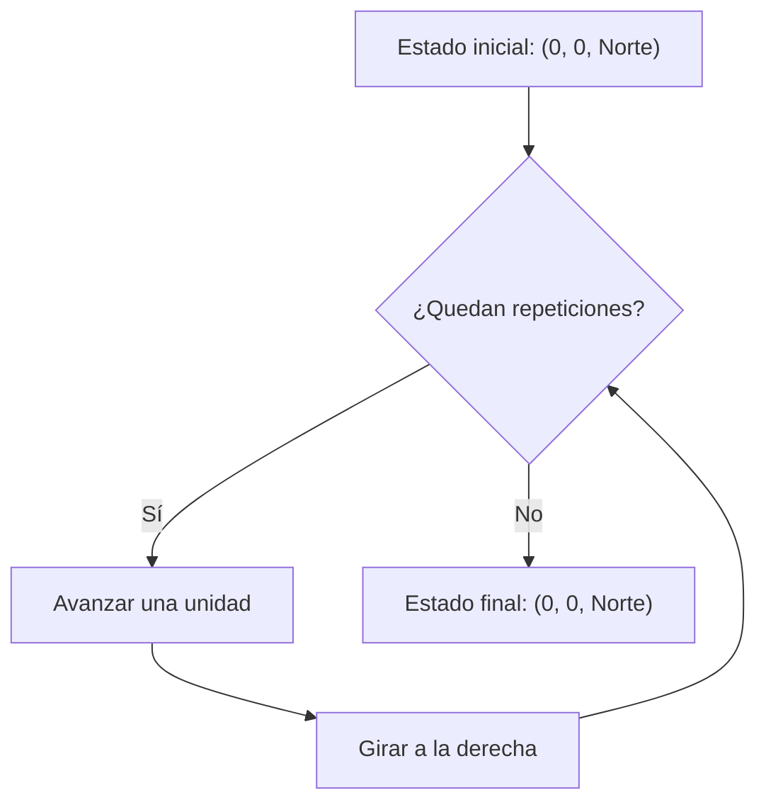
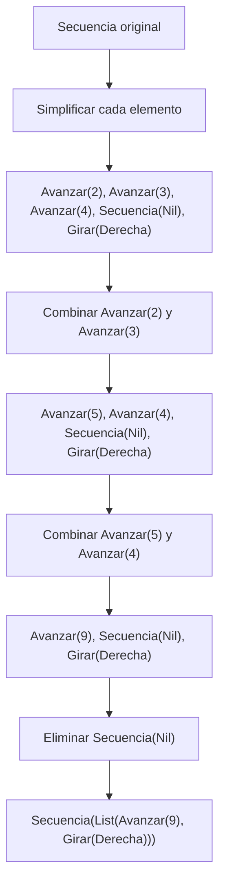

# Informe de proceso

## 1. Introducción

En este informe se describe el funcionamiento de las funciones implementadas en `RobotCuadricula`. Se explica cómo se ejecutan las órdenes del robot, cómo se calculan las propiedades de una orden compuesta y cómo se transforma una orden mediante la función `simplificar`.

El tipo `Orden` es recursivo y contempla cuatro alternativas: `Avanzar`, `Girar`, `Repetir` y `Secuencia`. Por ello, las funciones que procesan una orden distinguen cada alternativa y, cuando encuentran una orden compuesta, procesan recursivamente sus componentes.

## 2. Proceso de ejecución de `girar`

La función `girar(d, s)` recibe la dirección actual del robot y un sentido de giro. Devuelve la dirección que corresponde después de girar noventa grados.

Por ejemplo, si el robot está orientado al norte y gira a la derecha, pasa a estar orientado al este. Si gira a la izquierda, pasa a estar orientado al oeste.

| Dirección inicial | Giro a la derecha | Giro a la izquierda |
|---|---|---|
| Norte | Este | Oeste |
| Este | Sur | Norte |
| Sur | Oeste | Este |
| Oeste | Norte | Sur |

La función utiliza una expresión `match` que compara la dirección y el sentido del giro. Cada combinación devuelve directamente la dirección resultante.

## 3. Proceso de ejecución de `ejecutar`

La función `ejecutar(e, o)` recibe un estado `e` y una orden `o`. Devuelve el estado que resulta después de ejecutar la orden.

El estado contiene las coordenadas `x` e `y` y la dirección hacia la que mira el robot.

### 3.1. Ejecución de las órdenes básicas

**Orden `Avanzar(n)`.** El robot se desplaza `n` unidades en la dirección actual:

- Norte: aumenta `y`.
- Este: aumenta `x`.
- Sur: disminuye `y`.
- Oeste: disminuye `x`.

**Orden `Girar(sentido)`.** La posición permanece igual y cambia la dirección mediante la función `girar`.

Por ejemplo, desde `Estado(0, 0, Norte)`, ejecutar `Avanzar(1)` produce `Estado(0, 1, Norte)`. Si después se ejecuta `Girar(Derecha)`, el resultado es `Estado(0, 1, Este)`.

### 3.2. Ejecución de `Repetir`

La función procesa `Repetir(veces, orden)` de la siguiente manera:

1. Si `veces` es menor o igual que cero, devuelve el estado recibido sin modificarlo.
2. En caso contrario, ejecuta una vez la orden interna.
3. Ejecuta la misma orden `veces - 1` veces adicionales, utilizando el estado obtenido en el paso anterior.

La implementación realiza este proceso mediante una llamada recursiva a `ejecutar`.

### 3.3. Ejecución de `Secuencia`

La función procesa `Secuencia(ordenes)` en el orden de la lista:

1. Si la lista está vacía, devuelve el estado sin modificarlo.
2. Si la lista contiene una primera orden y el resto, ejecuta la primera orden.
3. Utiliza el estado resultante para ejecutar recursivamente las órdenes restantes.

De esta forma, cada instrucción comienza a ejecutarse desde el estado que dejó la anterior.

### 3.4. Traza completa de ejecución

Se considera la orden:

```scala
Repetir(
  4,
  Secuencia(List(Avanzar(1), Girar(Derecha)))
)
```

El estado inicial es `inicial = Estado(0, 0, Norte)`.

La orden repite cuatro veces la secuencia formada por avanzar una unidad y girar a la derecha.

| Paso | Instrucción ejecutada | Estado resultante | Instrucciones pendientes |
|---|---|---|---|
| 0 | Ninguna | `Estado(0, 0, Norte)` | 4 secuencias |
| 1 | `Avanzar(1)` | `Estado(0, 1, Norte)` | Girar a la derecha y 3 secuencias |
| 2 | `Girar(Derecha)` | `Estado(0, 1, Este)` | 3 secuencias |
| 3 | `Avanzar(1)` | `Estado(1, 1, Este)` | Girar a la derecha y 2 secuencias |
| 4 | `Girar(Derecha)` | `Estado(1, 1, Sur)` | 2 secuencias |
| 5 | `Avanzar(1)` | `Estado(1, 0, Sur)` | Girar a la derecha y 1 secuencia |
| 6 | `Girar(Derecha)` | `Estado(1, 0, Oeste)` | 1 secuencia |
| 7 | `Avanzar(1)` | `Estado(0, 0, Oeste)` | Girar a la derecha |
| 8 | `Girar(Derecha)` | `Estado(0, 0, Norte)` | Ninguna |

Al finalizar, el robot vuelve al origen y queda orientado al norte. Por tanto:

```scala
ejecutar(inicial, orden)
// Estado(0, 0, Norte)
```

### 3.5. Diagrama del proceso



El diagrama resume el comportamiento de la repetición: cada iteración ejecuta primero el avance y después el giro. Al agotarse las cuatro repeticiones, se devuelve el estado final.

## 4. Proceso de cálculo de las propiedades de una orden

### 4.1. Función `cuantasBasicas`

Esta función cuenta las órdenes básicas que se ejecutan, considerando el número de repeticiones.

- `Avanzar(_)` devuelve `1`.
- `Girar(_)` devuelve `1`.
- `Repetir(veces, orden)` devuelve `0` si `veces` es menor o igual que cero. En caso contrario, multiplica las veces por la cantidad de órdenes básicas de la orden interna.
- `Secuencia(ordenes)` suma las cantidades correspondientes a cada elemento de la lista.

Por ejemplo:

```scala
cuantasBasicas(
  Secuencia(List(Avanzar(1), Girar(Derecha)))
)
// 2
```

Si la misma secuencia se repite cuatro veces, el resultado es `8`, porque cada repetición contiene dos órdenes básicas.

### 4.2. Función `profundidad`

Esta función calcula los niveles de anidamiento de una orden.

- Las órdenes `Avanzar` y `Girar` tienen profundidad `1`.
- `Repetir(_, orden)` tiene una profundidad igual a `1 + profundidad(orden)`.
- `Secuencia(ordenes)` devuelve uno más que la profundidad máxima de sus elementos.

Para calcular la profundidad de una secuencia, se utiliza `map(profundidad)` para obtener las profundidades de sus elementos y `foldLeft(0)(_ max _)` para seleccionar la mayor. Si la secuencia está vacía, el máximo es `0` y la profundidad resultante es `1`.

Por ejemplo:

```scala
profundidad(
  Secuencia(List(Avanzar(1), Girar(Derecha)))
)
// 2
```

### 4.3. Función `componer`

Esta función recibe dos órdenes y construye una secuencia con ambas, manteniendo el orden recibido.

```scala
componer(Avanzar(1), Girar(Derecha))
```

produce:

```scala
Secuencia(List(Avanzar(1), Girar(Derecha)))
```

El robot ejecutará primero el avance y después el giro.

### 4.4. Función `rutina`

La función `rutina(pasos)(giro)(veces)` está currificada: recibe sus argumentos en tres grupos y construye una orden de repetición.

La orden interna contiene `Avanzar(pasos)` seguido de `Girar(giro)`, y toda la secuencia se repite `veces` veces.

Por ejemplo:

```scala
rutina(2)(Derecha)(3)
```

produce:

```scala
Repetir(
  3,
  Secuencia(List(Avanzar(2), Girar(Derecha)))
)
```

### 4.5. Función `aplicarA`

Esta función recibe una lista de estados y una orden. Mediante `map`, ejecuta la misma orden sobre cada estado y devuelve una lista con los resultados.

Conceptualmente, aplica la operación:

```scala
estados.map(e => ejecutar(e, o))
```

Cada estado se procesa independientemente, utilizando la misma orden.

### 4.6. Función `transformar`

Esta función recibe una orden y una función `f` que transforma órdenes básicas.

- Para `Avanzar` y `Girar`, aplica `f` directamente.
- Para `Repetir`, transforma recursivamente la orden interna y conserva el número de repeticiones.
- Para `Secuencia`, transforma recursivamente cada elemento y conserva el orden de la lista.

La función no simplifica automáticamente el resultado: su propósito es aplicar una transformación a las órdenes básicas y reconstruir la estructura compuesta.

## 5. Proceso de simplificación de órdenes

La función `simplificar` busca obtener una representación más corta de una orden. Para ello, utiliza tres funciones auxiliares:

- `esNada`: identifica una secuencia vacía, `Secuencia(Nil)`.
- `construir`: devuelve una secuencia vacía si no hay órdenes, la propia orden si solo hay una, o una secuencia si hay varias.
- `normalizar`: recorre una lista de órdenes y elimina o combina elementos según las reglas implementadas.

La función principal, `simplificarInterno`, recorre recursivamente la orden y aplica las reglas correspondientes a cada alternativa del tipo `Orden`.

### 5.1. Reglas de simplificación

**Caso 1. Avance de cero unidades.**

`Avanzar(0)` se reemplaza por `Secuencia(Nil)`, que representa una orden sin efecto.

**Caso 2. Avance distinto de cero.**

`Avanzar(n)` se conserva cuando `n` es distinto de cero.

**Caso 3. Giro.**

`Girar(sentido)` se conserva sin modificaciones.

**Caso 4. Repetición no positiva.**

`Repetir(veces, orden)` se reemplaza por una secuencia vacía cuando `veces` es menor o igual que cero. En ese caso, la orden interna no necesita simplificarse.

**Caso 5. Repetición unitaria.**

`Repetir(1, orden)` se reemplaza por la versión simplificada de `orden`, porque ejecutarla una sola vez no requiere una estructura de repetición.

**Caso 6. Repetición de varias veces.**

Se simplifica primero la orden interna. Si el resultado es una secuencia vacía, toda la repetición se reemplaza por una secuencia vacía. En caso contrario, se conserva `Repetir` con el número de repeticiones original y la orden interna simplificada.

**Caso 7. Secuencia.**

Se simplifica cada elemento recursivamente y después se aplica `normalizar` a la lista resultante.

### 5.2. Funcionamiento de `normalizar`

La función `normalizar` procesa la lista de izquierda a derecha mediante los siguientes casos:

1. Si la lista está vacía, devuelve una lista vacía.
2. Si el primer elemento es `Avanzar(0)`, lo elimina y continúa con el resto.
3. Si los dos primeros elementos son `Avanzar(a)` y `Avanzar(b)`, los reemplaza por `Avanzar(a + b)` y vuelve a procesar la lista.
4. Si el primer elemento es una secuencia vacía, lo elimina y continúa.
5. En cualquier otro caso, conserva el primer elemento y normaliza el resto.

Como la regla de combinación vuelve a procesar el avance resultante junto con el resto, es posible combinar varios avances consecutivos en una sola pasada recursiva.

### 5.3. Ejemplo de simplificación paso a paso

Se utiliza la siguiente orden:

```scala
Secuencia(List(
  Avanzar(2),
  Avanzar(3),
  Avanzar(4),
  Avanzar(0),
  Girar(Derecha)
))
```

**Paso 1. Simplificación de los elementos.**

Cada elemento se simplifica recursivamente. Los avances distintos de cero y el giro se conservan, mientras que `Avanzar(0)` se transforma en `Secuencia(Nil)`.

La lista resultante antes de normalizar es:

```scala
List(
  Avanzar(2),
  Avanzar(3),
  Avanzar(4),
  Secuencia(Nil),
  Girar(Derecha)
)
```

**Paso 2. Combinación de los dos primeros avances.**

La regla `Avanzar(a) :: Avanzar(b) :: resto` combina los avances consecutivos:

```scala
Avanzar(2) + Avanzar(3) = Avanzar(5)
```

La lista que queda por procesar es:

```scala
List(
  Avanzar(5),
  Avanzar(4),
  Secuencia(Nil),
  Girar(Derecha)
)
```

**Paso 3. Nueva combinación de avances.**

La función vuelve a aplicar la regla de combinación sobre el avance obtenido y el siguiente:

```scala
Avanzar(5) + Avanzar(4) = Avanzar(9)
```

La lista pendiente queda así:

```scala
List(
  Avanzar(9),
  Secuencia(Nil),
  Girar(Derecha)
)
```

**Paso 4. Eliminación de la secuencia vacía.**

Como `Secuencia(Nil)` no contiene ninguna instrucción, se elimina de la lista.

El resultado normalizado es:

```scala
List(
  Avanzar(9),
  Girar(Derecha)
)
```

**Paso 5. Reconstrucción de la orden.**

Como quedan dos órdenes, `construir` devuelve una secuencia:

```scala
Secuencia(List(
  Avanzar(9),
  Girar(Derecha)
))
```

Por tanto, la orden simplificada es:

```scala
simplificar(
  Secuencia(List(
    Avanzar(2),
    Avanzar(3),
    Avanzar(4),
    Avanzar(0),
    Girar(Derecha)
  ))
)

// Secuencia(List(Avanzar(9), Girar(Derecha)))
```

### 5.4. Diagrama de las transformaciones



El resultado conserva el avance total de nueve unidades y el giro a la derecha, pero elimina instrucciones innecesarias y combina los avances consecutivos.

## 6. Conclusión

Las funciones implementadas recorren y procesan las órdenes del robot según la estructura recursiva del tipo `Orden`. La función `ejecutar` calcula los estados resultantes respetando el orden de las instrucciones, mientras que las funciones de cálculo obtienen propiedades de las órdenes compuestas.

Por su parte, `transformar` aplica una transformación a las órdenes básicas y reconstruye la estructura original. Finalmente, `simplificar` reduce órdenes innecesarias mediante el procesamiento recursivo y la normalización de secuencias, combinando avances consecutivos y eliminando instrucciones sin efecto.

Estas trazas permiten comprender cómo se desarrolla la ejecución y cómo se transforma progresivamente una orden hasta obtener una representación más sencilla.
